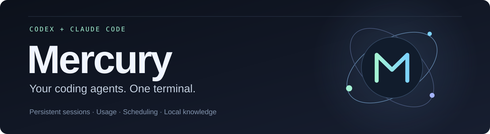
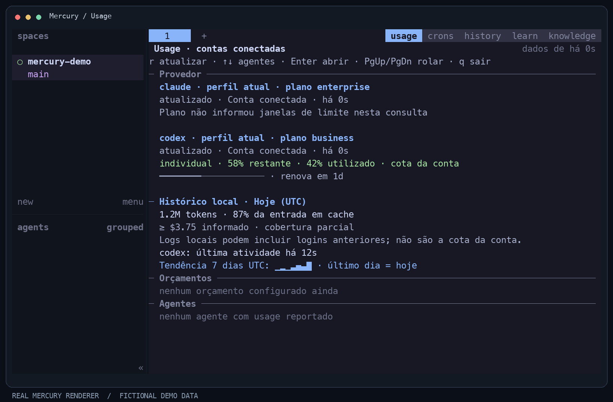
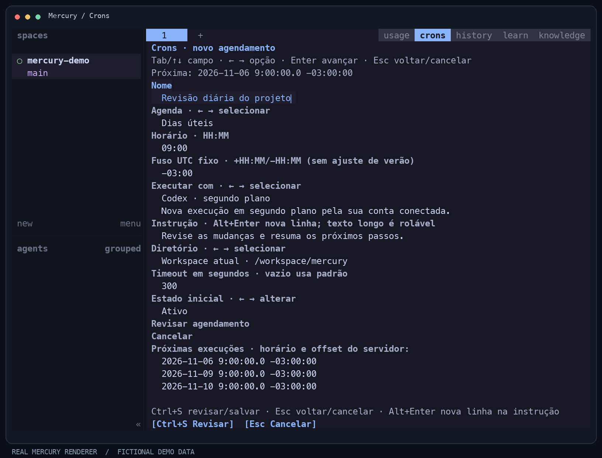

<p align="center">
  
</p>

<p align="center">
  <strong>A terminal workspace for Codex and Claude Code.</strong><br />
  Persistent sessions, account usage, guided scheduling, and local Markdown knowledge.
</p>

<p align="center">
  <a href="#quick-start">Quick start</a> · <a href="#what-you-can-do">Features</a> ·
  <a href="#in-the-terminal">Screenshots</a> · <a href="#documentation">Docs</a> ·
  <a href="README.pt-BR.md">Português</a>
</p>

<p align="center">
  <a href="Cargo.toml"></a>
  <a href="#project-status"></a>
  <a href="LICENSE"></a>
</p>

Mercury brings the coding CLIs you already use into one persistent workspace.
Keep terminals running when you detach, see the limits your accounts report,
schedule repeatable work, and retrieve knowledge from your Markdown notes.

## In the terminal

### See account limits at a glance



Account limits are separate from local token and cost history. When a provider
does not report a quota, Mercury explains that instead of inventing a number.

### Schedule work without writing cron expressions



Choose a schedule and executor, check the timezone and next run, then review
before saving. Edit, pause, run now, and delete are available in the interface.

<sub>Images use the actual Mercury renderer with fictional demo data. The current
interface includes Portuguese labels. See <a href="assets/mercury/README.md">asset sources and regeneration</a>.</sub>

## What you can do

| Capability | In practice |
| --- | --- |
| **Persistent workspaces** | Keep agent terminals running while the client is detached; organize work with tabs and panes. |
| **Connected-account usage** | Read Codex and Claude account metadata, available limits, resets and the age of each reading. |
| **Guided scheduling** | Pick weekdays, daily/monthly schedules, intervals or a one-time run; advanced cron expressions remain available. |
| **Agent routing** | Apply routing rules to Codex/Claude tasks and inspect the selection before submitting work. |
| **Markdown memory + GraphRAG** | Index an Obsidian-compatible vault, retrieve source passages, and generate cited answers with opt-in model access. |
| **History and Learn** | Find past conversations; optionally apply allowlisted improvements with backups, an audit trail and undo. |

## Quick start

### 1. Install the prerequisites

- [Rust through rustup](https://rustup.rs/). The toolchain is pinned in [`rust-toolchain.toml`](rust-toolchain.toml).
- [Zig 0.16.0](https://ziglang.org/download/) on `PATH`, or set `ZIG` to its executable. Mercury uses the vendored Ghostty terminal library.
- Codex CLI and/or Claude Code, installed and authenticated separately.

### 2. Build and open Mercury

```sh
git clone https://github.com/felipetomelin/mercury.git
cd mercury
cargo build --release --locked
./target/release/mercury config check
./target/release/mercury
```

This is a **source build**. Prebuilt releases, package-manager installation and
the Mercury update feed are not published yet.

### 3. Explore the workspace

Click **usage**, **crons**, **history**, **learn** or **knowledge** in the tab bar.
In the default keymap, `Ctrl+B` then `u` opens Usage and `Ctrl+B` then `Shift+C`
opens Crons. Use `a` to create a schedule, `e` to edit and `d` to delete it.

With Mercury running, a second terminal can inspect its state:

```sh
./target/release/mercury status
./target/release/mercury cron list
./target/release/mercury cron doctor
./target/release/mercury knowledge status --json
```

## Bring your notes into the workflow

Mercury reads Markdown files directly, including Obsidian-style links. Obsidian
does not need to be running. Start with local indexing in your Mercury config:

```toml
[knowledge]
enabled = true
vault = "/absolute/path/to/your/vault"
allow_external = false
```

After reloading the config:

```sh
./target/release/mercury server reload-config
./target/release/mercury knowledge index --json
./target/release/mercury knowledge search --query "deployment decisions" --json
```

Text search and explicit links stay local. Graph extraction, model-assisted search
and generated answers use your authenticated Codex/Claude CLIs only after explicit
configuration of external access. Responses carry source references; inferred
relations remain distinct from reviewed decisions.

→ [Knowledge and GraphRAG setup](docs/knowledge/README.md)

## Project status

An independent project under active development, based on
[herdr v0.9.3](https://github.com/herdrdev/herdr/tree/v0.9.3).

| Platform | Current status |
| --- | --- |
| **macOS** | Local development and validation environment. |
| **Linux** | Build paths exist; needs platform-specific qualification. |
| **Windows** | Experimental; local Knowledge storage currently requires Unix permissions. |

Detach preserves running processes while the server remains alive. Server/machine
restart can restore saved layout/session state; it does not preserve the original
processes. Provider limits depend on what each account and CLI exposes. Learn is
disabled by default. See the [validation report](docs/dev/usage-cron-009-review.md)
for the tested scope and known limits.

## Documentation

- [Usage, scheduling and memory guide](docs/dev/usage-cron-guide.md)
- [Knowledge / Obsidian / GraphRAG](docs/knowledge/README.md)
- [Development and advanced local operation](DEVELOPMENT.md)
- [API schema](docs/next/api/mercury-api.schema.json)
- [Plan and implementation history](PLAN.md)
- [Contributing](CONTRIBUTING.md) · [Security](SECURITY.md)

## Credits and license

Mercury builds on herdr and the work of its contributors. Terminal rendering uses
Ghostty components; vendored dependencies retain their notices and licenses.
Mercury adds account usage, routing, guided scheduling, history, local knowledge
and opt-in learning workflows to this foundation.

[Apache License 2.0](LICENSE) · [Attribution and modifications](NOTICE)
