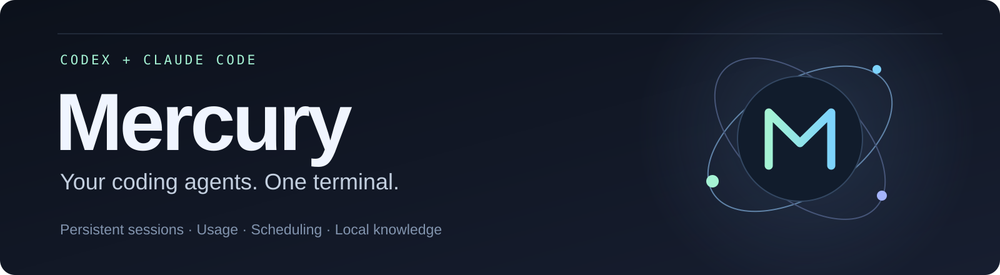
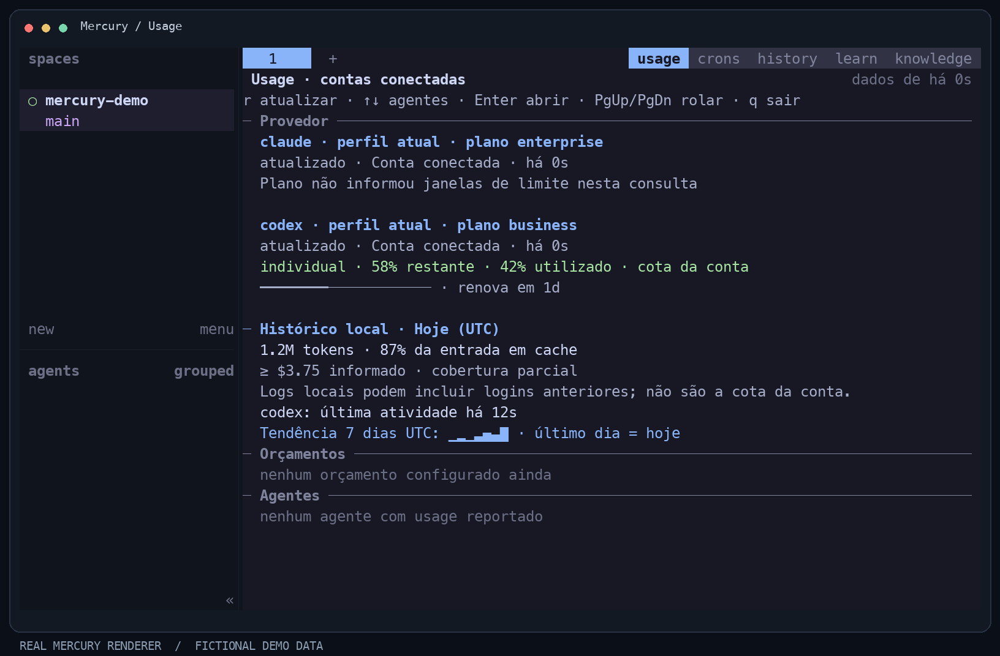
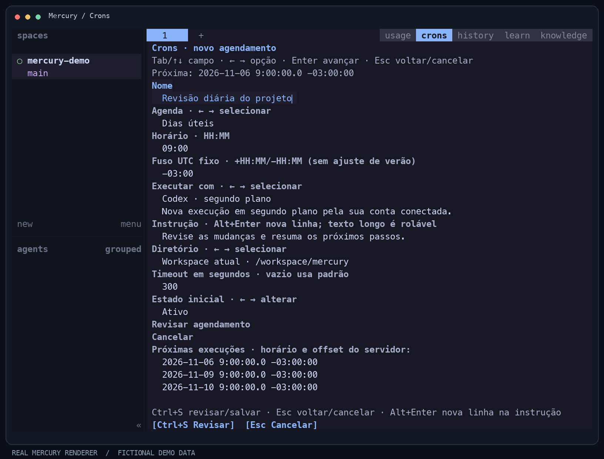

<p align="center">
  
</p>

<p align="center">
  <strong>Um workspace no terminal para Codex e Claude Code.</strong><br />
  Sessões persistentes, uso das contas, agendamentos guiados e memória Markdown local.
</p>

<p align="center">
  <a href="#comece-aqui">Comece aqui</a> · <a href="#o-que-você-pode-fazer">Recursos</a> ·
  <a href="#na-prática">Imagens</a> · <a href="#documentação">Documentação</a> ·
  <a href="README.md">English</a>
</p>

O Mercury reúne os CLIs de programação que você já utiliza em um workspace
persistente. Mantenha terminais ativos ao desconectar a interface, acompanhe os
limites informados pelas contas, agende tarefas e consulte suas notas Markdown.

## Na prática

### Entenda o uso das suas contas



Os limites da conta aparecem separados do histórico local de tokens e custos.
Quando o provedor não informa uma cota, a interface explica a ausência do dado.

### Agende tarefas sem escrever uma expressão cron



Escolha agenda e executor, confira o fuso e a próxima execução e revise antes de
salvar. A interface também oferece edição, pausa, execução imediata e exclusão.

<sub>Imagens geradas pelo renderer real do Mercury com dados fictícios.
Veja as <a href="assets/mercury/README.md">fontes e a reprodução das imagens</a>.</sub>

## O que você pode fazer

| Recurso | No dia a dia |
| --- | --- |
| **Workspaces persistentes** | Organize agentes em abas e painéis e mantenha seus terminais ativos ao desconectar o cliente. |
| **Uso das contas conectadas** | Consulte planos, limites disponíveis, renovação e idade dos dados de Codex e Claude. |
| **Agendamentos guiados** | Escolha dias úteis, agenda diária/mensal, intervalos ou execução única; expressões avançadas continuam disponíveis. |
| **Roteamento de agentes** | Aplique regras para tarefas Codex/Claude e inspecione a escolha antes de enviá-las. |
| **Memória Markdown + GraphRAG** | Indexe um vault compatível com Obsidian e gere respostas com fontes, mediante acesso a modelos configurado explicitamente. |
| **Histórico e Learn** | Encontre conversas anteriores e habilite melhorias em alvos permitidos, com backup, auditoria e undo. |

## Comece aqui

### 1. Prepare os pré-requisitos

- [Rust com rustup](https://rustup.rs/). A versão está fixada em [`rust-toolchain.toml`](rust-toolchain.toml).
- [Zig 0.16.0](https://ziglang.org/download/) no `PATH`, ou a variável `ZIG` apontando para o executável. O Mercury utiliza a biblioteca de terminal Ghostty.
- Codex CLI e/ou Claude Code instalados e autenticados separadamente.

### 2. Compile e abra o Mercury

```sh
git clone https://github.com/felipetomelin/mercury.git
cd mercury
cargo build --release --locked
./target/release/mercury config check
./target/release/mercury
```

A distribuição atual é pelo **código-fonte**. Ainda não há releases binárias,
instalação por gerenciador de pacotes ou feed de atualização publicado.

### 3. Explore o workspace

Clique nas abas **usage**, **crons**, **history**, **learn** e **knowledge**.
Nos atalhos padrão, `Ctrl+B` seguido de `u` abre Usage; `Ctrl+B` seguido de
`Shift+C` abre Crons. Use `a` para criar, `e` para editar e `d` para excluir.

Com o Mercury aberto, um segundo terminal pode consultar:

```sh
./target/release/mercury status
./target/release/mercury cron list
./target/release/mercury cron doctor
./target/release/mercury knowledge status --json
```

## Conecte suas notas ao trabalho

O Mercury lê arquivos Markdown e links no estilo Obsidian. O Obsidian pode
permanecer fechado. Comece com a indexação local na configuração do Mercury:

```toml
[knowledge]
enabled = true
vault = "/caminho/absoluto/para/seu/vault"
allow_external = false
```

Depois de recarregar a configuração:

```sh
./target/release/mercury server reload-config
./target/release/mercury knowledge index --json
./target/release/mercury knowledge search --query "decisões de deploy" --json
```

Busca textual e links explícitos ficam locais. Extração de grafos, busca assistida
por modelos e respostas geradas usam os CLIs autenticados Codex/Claude somente
com acesso externo configurado explicitamente. As respostas trazem referências;
relações inferidas permanecem distintas das decisões revisadas.

→ [Configuração de Knowledge e GraphRAG](docs/knowledge/README.md)

## Estado do projeto

Projeto independente em desenvolvimento ativo, baseado no
[herdr v0.9.3](https://github.com/herdrdev/herdr/tree/v0.9.3).

| Plataforma | Situação atual |
| --- | --- |
| **macOS** | Ambiente de desenvolvimento e validação local. |
| **Linux** | Há suporte de compilação; falta qualificação específica da plataforma. |
| **Windows** | Experimental; o armazenamento local Knowledge exige permissões Unix neste ciclo. |

Desconectar a interface preserva processos enquanto o servidor continua ativo.
Reiniciar servidor ou máquina permite restaurar layout/sessões salvos, mas não
preserva os processos originais. As cotas dependem do que cada conta/CLI informa.
Learn começa desativado. O [relatório de validação](docs/dev/usage-cron-009-review.md)
descreve o escopo testado e as limitações.

## Documentação

- [Guia de Usage, agendamentos e memória](docs/dev/usage-cron-guide.md)
- [Knowledge / Obsidian / GraphRAG](docs/knowledge/README.md)
- [Desenvolvimento e operação avançada](DEVELOPMENT.md)
- [Schema da API](docs/next/api/mercury-api.schema.json)
- [Plano e histórico de implementação](PLAN.md)
- [Como contribuir](CONTRIBUTING.md) · [Segurança](SECURITY.md)

## Créditos e licença

O Mercury utiliza a base do herdr e o trabalho de seus contribuidores. A
renderização utiliza componentes Ghostty; as dependências mantêm suas licenças
e avisos. O Mercury acrescenta uso das contas, roteamento, agendamentos guiados,
histórico, conhecimento local e aprendizado opt-in.

[Apache License 2.0](LICENSE) · [Atribuição e modificações](NOTICE)
