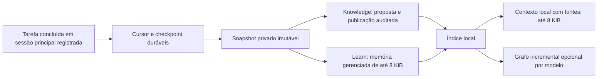

# Memória contínua: checkpoints → Learn / notas → contexto

Learn e Knowledge usam diretórios e configuração da instalação ativa do Mercury.
Não há caminho de usuário, vault pessoal ou sessão fixa no código. Sem `vault`,
Knowledge prepara `<dados-do-Mercury>/knowledge/vault`; a memória fica em
`Mercury/LearnMemory.md` nesse vault. Um vault configurado pode ser uma pasta
normal ou Obsidian; o aplicativo Obsidian não precisa estar aberto.

Ambas as features estão habilitadas por padrão, mas processamento externo exige
consentimento explícito. `enabled = false` continua sendo respeitado. Windows
não habilita gravações automáticas sem o suporte necessário a armazenamento
privado; os controles atuais de escrita são para plataformas Unix.



## Configurar uma instalação

O arquivo ativo é o indicado pelo Mercury na instalação/namespace em uso.
Exemplo para uma máquina com Codex autenticado:

```toml
[learn]
enabled = true
allow_external = true
weekly = true

[knowledge]
enabled = true
# Omita vault para usar o vault privado gerenciado.
# vault = "/caminho/absoluto/do/vault/desta/instalacao"
allow_external = true
allowed_providers = ["codex"]

[knowledge.automation]
enabled = true
capture = true
publish = true
graph = true
poll_secs = 30
debounce_secs = 5
retry_secs = 60
max_attempts = 5
daily_model_calls = 64
```

Use `claude` ou ambos em `allowed_providers` conforme os CLIs instalados. Os
executáveis são resolvidos no PATH do servidor; alternativamente configure
`knowledge.executables` por instalação. Autentique nos próprios CLIs, sem colocar
tokens no repositório ou no TOML. `learn.allow_external` e
`knowledge.allow_external` são consentimentos independentes. Não habilitam
`knowledge.allow_route_external`, nem injeção automática no prompt dos agentes.

```sh
mercury integration install codex
mercury integration install claude   # se usar Claude
mercury config check
mercury server reload-config
mercury knowledge doctor --json
mercury learn status --json
mercury knowledge status --json
```

O doctor verifica configuração efetiva, vault, registro global dos hooks e
contrato dos CLIs por `--version`/`--help`, sem inferência. Ele funciona mesmo
quando falta consentimento ou executável. `authenticated_smoke` não constitui
validação de autenticação. Overrides de projeto/plugins devem preservar os hooks
Mercury; o diagnóstico informa o alcance global da inspeção.

## Quando acontece a captura

- Codex: registros nativos `event_msg.task_complete` delimitam tarefas completas.
- Claude: hooks `Stop` e `SessionEnd` registram o limite do transcript antes do
  reconhecimento. A próxima tarefa pode começar sem entrar no snapshot anterior.
- Fallback explícito: `mercury knowledge checkpoint --provider codex --id SESSION`
  (ou `claude`) declara concluído o trecho atual de uma sessão já registrada.
  Não aceita caminhos arbitrários nem promove uma sessão não registrada.

Só sessões principais ligadas a hooks gerenciados/terminais persistidos do
Mercury são observadas. Reinício, reload e handoff preservam registros, cursores,
limites solicitados e exclusões por automação. Se o hook fornecer somente o ID,
a resolução por ID exato ocorre no worker, usando o home configurado do provedor.
Não se escolhe o transcript mais recente. Uma instalação nova não reprocessa
conclusões anteriores ao registro; comece uma nova tarefa ou solicite checkpoint.

O diário local é independente da amostra enviada ao modelo. Chats maiores que
4 MiB e turnos antigos descartados da amostra não anulam novos checkpoints.
Cada passagem lê até 1 MiB por fonte (com verificação do trecho consumido), até
oito fontes; preserva no máximo 64 mensagens/64 KiB de texto por janela. Linhas
grandes de ferramentas são puladas com alocação limitada. Linhas finais parciais
aguardam conclusão. Reescrita, truncamento, troca de identidade e symlinks geram
bloqueio visível; crescimento posterior não altera snapshots já persistidos.

## Escrita, custo e recuperação

Checkpoints automáticos só oferecem ao Learn o alvo reservado `mercury-memory`,
cujo caminho e teto são sempre derivados da instalação/vault, mesmo se um alvo
legado tiver reutilizado esse ID. Configurações
legadas com alvos explícitos continuam atendendo seus fluxos antigos, sem ampliar
os novos checkpoints para código, skills, instruções, roteamento ou crons. Learn
mantém `status: proposed`, teto de 8 KiB, comparação dos bytes e undo auditado.
Propostas idênticas à memória atual são `no_change`, sem nova gravação.

Knowledge mantém estados separados de captura, proposta, publicação e grafo.
Lições com corpo idêntico no mesmo projeto reutilizam a proposta e registram cada
origem como `no_change`. Notas automáticas incluem vínculo para a memória
gerenciada quando ela está indexada. Sem aprendizado reutilizável, o modelo pode
devolver Markdown vazio, também registrado como `no_change`. Propostas publicadas continuam `proposed` epistemicamente, até revisão
humana. Alterações manuais nas notas impedem sobrescrita/undo conflitante.

O orçamento diário é persistente e compartilhado com Learn; cada chamada
estruturada reserva conservadoramente duas tentativas para cobrir fallback.
Knowledge aguarda o próximo dia UTC quando a quota diária se esgota. Learn
repete falhas com backoff de 60 segundos até cinco tentativas; depois informa
`failed` e oferece recuperação focal. Um claim interrompido exige essa recuperação
explícita, preservando o registro para auditoria. Falha do grafo não remove uma nota já
publicada nem impede busca/contexto local. Extrações por chunk e resumos já
existentes continuam sendo reutilizados pelo grafo incremental.

```sh
# Prévia e recuperação focal: preserve proposta/inferência já persistida.
mercury knowledge retry CAPTURE_ID --json
mercury knowledge retry CAPTURE_ID --apply --json
# Checkpoint Learn com estado failed, após corrigir a causa:
mercury knowledge retry CHECKPOINT_ID --mode retry-learn --json
mercury knowledge retry CHECKPOINT_ID --mode retry-learn --apply --json
# Reverter nota publicada ou alteração da memória:
mercury knowledge review PROPOSAL_ID --mode undo --json
mercury learn undo CHANGE_ID --json
```

Os IDs recentes e estados de cada consumidor aparecem nos status. Uma captura
legada presa a um transcript vivo alterado não tem seu fingerprint redefinido:
a prévia informa `requires_new_checkpoint`. Gere um novo checkpoint confiável.
Schemas anteriores são preservados; as tabelas do diário são aditivas/idempotentes.
Até 1.024 checkpoints concluídos por ambos os consumidores são retidos; a fila
total é limitada a 4.096 checkpoints, 256 fontes e 64 limites de hook por fonte.
Ao atingir limites há erro/bloqueio visível; trabalho pendente não é descartado.

## Recuperar contexto com baixo custo

```sh
mercury knowledge index --json
mercury context build --query "decisões de deployment" --project PROJETO --json
```

`context build` usa FTS, similaridade por vetores hash locais e um salto por
relações explícitas. Não depende de CLI autenticado, grafo extraído nem chamadas
LLM. O cache inclui revisão do índice, projeto, consulta, política de confiança,
algoritmo e limites. Mudança de conteúdo/status invalida a revisão. São até oito
chunks, com diversidade por nota e deduplicação por texto/status. Decisões
validadas, fontes pendentes e depreciadas permanecem identificadas separadamente.
O JSON completo, incluindo caminhos, citações e orçamento, cabe em 8 KiB. Tokens
são estimados por bytes/4, claramente rotulados; não equivalem a um tokenizer.
O cache mantém até 512 pacotes; respostas GraphRAG opcionais têm cache separado
de até 128 entradas por consulta, modelo, grafo, revisão, filtro e orçamento. APIs verificam se o vault ainda corresponde à
revisão antes de servir contexto. Busca `hybrid` e `ask` continuam sendo opções
separadas com inferência explícita e regras de egress próprias.

## Validar no repositório

`just test-memory` executa contratos com SQLite, snapshots e vaults temporários,
sem credenciais. O CI executa esse grupo em Linux/macOS. O teste de integração
`native_checkpoint_feeds_memory_and_notes_and_recovers_after_both_workers_restart`
exercita os workers reais com um CLI sintético: captura, memória, nota, reinício,
`no_change`, deduplicação, 100 contextos sem novos gastos e undo. Smokes ignorados
com modelo real exigem ativação explícita e continuam separados dessa evidência.
