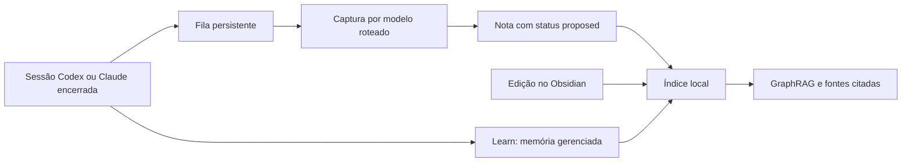

# Aprendizado contínuo: Learn → notas → grafo

Learn e Knowledge estão habilitados por padrão. Sem configuração, usam somente
escopo gerenciado e não enviam conteúdo a modelos externos. Um `enabled = false`
existente continua sendo respeitado; a mudança de default não remove seu opt-out.



## Habilitar processamento por modelos

No arquivo ativo mostrado por `mercury --help`, configure explicitamente:

```toml
[learn]
enabled = true
allow_external = true
review_every_turns = 12
weekly = true

[knowledge]
enabled = true
vault = "/caminho/absoluto/para/seu/vault"
allow_external = true
allowed_providers = ["codex", "claude"]

[knowledge.automation]
enabled = true
capture = true
publish = true
graph = true
poll_secs = 30
debounce_secs = 5
retry_secs = 60
max_attempts = 5
daily_model_calls = 64
```

Quem já usava apenas `learn.enabled = true` precisa acrescentar
`learn.allow_external = true` para continuar as revisões por modelo.

Use apenas provedores disponíveis/autenticados. Autenticação continua nos CLIs;
não coloque tokens na configuração. O modelo recebe trechos selecionados das
sessões/notas. Exclua pastas que não devem participar usando `knowledge.exclusions`.

```sh
mercury config check
mercury server reload-config
mercury learn status
mercury knowledge status --json
```

Sem `vault`, o servidor cria um vault privado em `<dados-da-sessão>/knowledge/vault`.
Sem `learn.target`, o único alvo de Learn é `Mercury/LearnMemory.md`, limitado a
8 KiB, dentro do vault (ou memória privada própria quando Knowledge está desligado).
AGENTS.md, skills, roteamento e crons humanos exigem alvos explícitos, como antes.
Nenhum arquivo humano é adotado como alvo por uma busca automática.

## O que dispara o fluxo

- **Sessão encerrada reconhecida no Mercury:** captura o aprendizado e publica
  uma nota proposta; depois indexa e atualiza o GraphRAG. Sessões executadas fora
  do Mercury não são varridas indiscriminadamente.
- **A cada 12 turnos do usuário:** Learn revisa a conversa concluída até aquele
  marco. Isso não publica uma captura de sessão ainda em andamento.
- **Revisão semanal:** mantém a revisão/curadoria conservadora existente de Learn.
- **Mudança no vault:** polling local detecta criação, edição e remoção de notas;
  o debounce confirma uma revisão estável antes de indexar.

Learn usa a mesma infraestrutura Codex/Claude de Knowledge, com roteamento,
fallback, limites observados e subprocessos sem ferramentas. Regras com tags
`["learn", "review"]` selecionam o revisor; Knowledge preserva suas tags
`knowledge/extract`, `knowledge/summarize` e `knowledge/answer`. O modelo Claude
usa `learn.model` como fallback de configuração; Codex usa o modelo configurado
em Knowledge ou o default do CLI. Snapshots completos dos alvos são preservados;
conversas longas podem ser amostradas com indicação de truncamento.

## Publicação e confiança

`publish = true` dispensa o aceite manual por sessão. O writer continua usando
journal, identidade estável e detecção de conflito; notas automáticas ficam em
`Mercury/` com `status: proposed`. O ledger pode dizer `accepted` porque a
publicação foi concluída: isso não representa validação humana.

Revise uma nota e altere seu frontmatter para `status: validated` quando fizer
sentido. Relações extraídas pelo modelo continuam inferidas. O grafo derivado fica
no índice privado; o Obsidian mostra os wikilinks presentes nas notas. Não há
exportação automática de toda inferência como uma relação humana aprovada.

```sh
mercury knowledge proposals --json
mercury knowledge review --id ID --mode undo --json
mercury learn list
mercury learn undo CHANGE_ID
```

Undo recusa substituir uma edição humana posterior. Captura e publicação são
deduplicadas por provedor, sessão e fingerprint. Após persistir uma proposta,
retomar a etapa de publicação não exige outra chamada ao modelo. Trabalhos
persistidos são retomados após reinício; um sinal ainda apenas na fila de entrada
em memória pode ser perdido em uma queda abrupta antes de ser gravado.

## Estado, custos e recuperação

`mercury knowledge status --json` informa fila, capturas concluídas/falhas,
último estado do monitor, estado do grafo e reservas de chamadas no dia UTC.
Na aba Knowledge, `r` atualiza esse resumo; Learn também informa se o revisor está
ativo, aguardando configuração ou indisponível. A geração de um grafo pode continuar
pendente depois de a captura já estar concluída e pesquisável localmente.

`daily_model_calls` é um teto persistente por sessão Mercury. Cada chamada
estruturada automática reserva duas tentativas de provedor, cobrindo o fallback;
a reserva é conservadora e não é uma contagem de tokens. Learn roteado e Knowledge
compartilham esse orçamento. Quando ele acaba, Knowledge aguarda o próximo dia
UTC; gatilhos Learn que falham ficam registrados e não são reenviados silenciosamente.
Claude mantém seu teto USD por chamada/revisão. Codex pode não reportar custo USD;
nesse caso o custo é desconhecido, nunca fabricado como zero.

Falhas têm backoff e limite de tentativas; mudanças de fontes exigem novo índice.
Para solicitar recuperação das capturas esgotadas e do grafo:

```sh
mercury knowledge index --rebuild --json
```

Fontes intactas reutilizam extrações. O monitor faz scan periódico limitado do
vault; ele não é um watcher nativo de eventos do filesystem. Conteúdo com padrões
reconhecíveis de credenciais bloqueia chamadas automáticas; essa triagem é limitada
e não garante detectar todo segredo. Erros exibidos são sanitizados.

## Pausar ou desabilitar

- `learn.enabled = false`: para a revisão Learn.
- `knowledge.automation.enabled = false`: mantém consulta manual, pausa automação.
- `knowledge.enabled = false`: desliga Knowledge.
- `allow_external = false`, em cada seção: impede novas chamadas ao modelo;
  Knowledge continua indexando localmente e aguardando configuração para capturas.

Recarregue a configuração após alterar. Cancelamento preserva etapas já gravadas;
não equivale a undo. Handoff desativa os workers antigos e uma lease impede
gerações do monitor de escreverem simultaneamente. A anexação de contexto aos
prompts Route permanece sujeita a `allow_route_external` e destinos explícitos.

macOS é o ambiente de validação desta entrega; as restrições existentes para
Linux/Windows e o armazenamento privado continuam descritas no guia principal.
